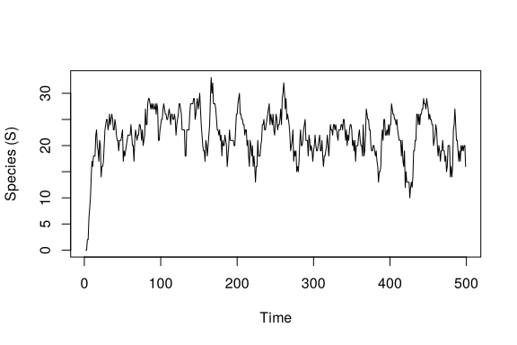
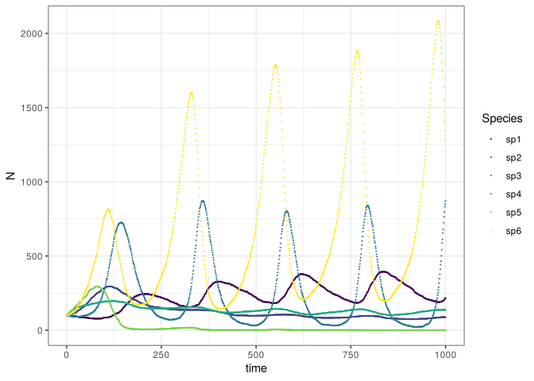

# meweasmo R-package: MEta-WEb ASsembly MOdels

[](https://zenodo.org/badge/latestdoi/130283899)

This package simulates the assembly of ecological networks from a
regional metaweb. Three main models are implemented; first the trophic
theory of island biogeography \[2\] with the addition that secondary
extinctions are not fixed but happen with a defined probability. Second
a generalized Lotka-Volterra stochastic model. Third, a multilayer
version of the first model in which non-trophic interactions (mutualism,
facilitation, competition) change the extinction rates. Species can
migrate from the metaweb and establish the ecological interactions
specified in the metaweb.

License: MIT

## Installation

Using the ‘devtools’ package:

``` r


install.packages("devtools")
library(devtools)
install_github('lsaravia/meweasmo')
library(meweasmo)
```

## Get started with the trophic assembly model

[`metaWebNetAssemblyCT()`](https://lsaravia.github.io/meweasmo/reference/metaWebNetAssemblyCT.md)
simulates the assembly of a local food web from a regional metaweb in
continuous time, following the trophic theory of island biogeography
\[2\] as extended in \[1\]:

- species arrive from the metaweb with migration rate *m*,
- present species go extinct with rate *e*,
- predators with no prey in the local web go extinct with the secondary
  extinction rate *se*.

Only the links among the species present are realized. The metaweb is a
logical matrix where `metaW[j, i]` is `TRUE` if species *j* is a prey of
species *i*. As an example we build a random metaweb of 40 species in
which species only eat species with a lower index, so the first ones are
basal:

``` r

library(meweasmo)
set.seed(1)
S0 <- 40
metaW <- matrix(FALSE, S0, S0)
metaW[upper.tri(metaW)] <- runif(S0 * (S0 - 1) / 2) < 0.1
sum(colSums(metaW) == 0)               # basal species
#> [1] 14
```

Simulate 500 time units with the same rates for all species:

``` r

tf <- 500
sim <- metaWebNetAssemblyCT(metaW, m = rep(0.1, S0), e = rep(0.05, S0), se = rep(0.5, S0), time = tf)
names(sim)
#> [1] "S"     "L"     "STime" "A"
```

`S` and `L` are the number of species with trophic links and of links in
the local web at each time, `STime` the presence of each species
(species x time) and `A` the adjacency matrix of the local web at the
end:

``` r

plot(2:(tf - 1), sim$S[2:(tf - 1)], type = "l", xlab = "Time", ylab = "Species (S)")
```



``` r

c(metaweb_S = S0, local_S = mean(sim$S[400:(tf - 1)]),
  local_C = mean(sim$L[400:(tf - 1)] / sim$S[400:(tf - 1)]^2))
#>   metaweb_S     local_S     local_C 
#> 40.00000000 20.83000000  0.05500939
```

The local web reaches a stochastic equilibrium below the size of the
metaweb, set by the balance between migration and (primary and
secondary) extinction. In \[1\] the rates *m*, *e* and *se* are fitted
by approximate Bayesian computation to the number of species and the
connectance of empirical food webs.

## Multilayer networks: trophic and non-trophic interactions

[`metaWebNetAssemblyML()`](https://lsaravia.github.io/meweasmo/reference/metaWebNetAssemblyML.md)
extends
[`metaWebNetAssemblyCT()`](https://lsaravia.github.io/meweasmo/reference/metaWebNetAssemblyCT.md)
to multilayer networks. The trophic layer defines the meta-web and the
secondary extinctions, as in
[`metaWebNetAssemblyCT()`](https://lsaravia.github.io/meweasmo/reference/metaWebNetAssemblyCT.md);
the non-trophic layers change the extinction rates: losing a mutualist
or a habitat provider raises the extinction rate of a species, losing a
competitor lowers it. Optionally, species can depend obligately on
others (e.g. foundation species). The network can be an `mgraph` from
the [multiweb](https://github.com/lsaravia/multiweb) package, a list of
igraph layers, or an edge list.

``` r

fpath <- system.file("extdata", package = "multiweb")
dn <- list.files(fpath, pattern = "^Kefi2015.*\\.txt$")
mg <- multiweb::readMultiplex(dn, types = c("Negative", "Positive", "Trophic"), fpath, skipColumn = 2)

# sign of the effect received by the species at the origin and at the end of each link
layers <- data.frame(layer = c("Trophic", "Positive", "Negative"), sign_from = c(-1, 1, -1),
                     sign_to = c(1, 0, 0), rule = c("trophic", "modifier", "modifier"))

r <- metaWebNetAssemblyML(mg, layers, beta = c(pos = 1, neg = 1), m = 0.1, e = 0.05, se = 0.5, time = 300)
```

See the article [Assembly of multilayer
networks](https://lsaravia.github.io/meweasmo/articles/multilayer-assembly.html)
([`vignette("multilayer-assembly")`](https://lsaravia.github.io/meweasmo/articles/multilayer-assembly.md))
for a worked example with the Chilean rocky intertidal network of Kéfi
et al. (2015).

## Get Started with Generalized Lotka-volterra model

### Simulate a 6 species network without migration

- Create a metaweb with a Lotka-Volterra interaction matrix structure, I
  added one last column with intrinsic growth rate.

``` r


library(tibble)

parms <- tibble::tribble(
  ~a1,   ~a2,  ~a3,    ~a4,   ~a5,  ~a6,    ~r,
    0,  4e-6, 3e-5,   2e-5,     0,    0,  -0.01,
-1e-5, -1e-4,    0,   1e-4,  6e-5,    0, -0.001,
-1e-4,     0,    0,      0,  6e-5, 5e-5,  -0.01,
-1e-4,  1e-4,    0,  -5e-4, -1e-5,    0,   0.08,
    0, -1e-4,-1e-4,      0, -1e-6,    0,   0.04,
    0,     0,-1e-4,   2e-4,     0,    0,   0.00
)
```

- Set the initial conditions and simulate the model with no migration
  during 1000 time steps

``` r


library(meweasmo)

yini  <- c(N1 = 100, N2 = 100, N3 = 100, N4 = 100, N5 = 100, N6 = 100)

A <- as.matrix(parms[,1:6])
r<- as.numeric(parms$r)
m <- c(0,0,0,0,0,0)
```

- We can calculate the proportions of the different types of
  interactions using the metaweb matrix and the vector of species
  present, in this case all species

``` r


calcPropInteractionsGLVadjMat(A,yini)
#> [1] 0.2 0.6 0.0 0.1 0.1
```

- then run de simultation

``` r


set.seed(42)
A1 <- metaWebNetAssemblyGLV(A,m,r,yini,1000,0.1)
```

- Check the results of the simulation: the abundances and the proportion
  of interactions, at the last time step

``` r


A1$STime[,1000]
#> [1]  218   88  871  137    0 1212

calcPropInteractionsGLVadjMat(A,A1$STime[,1000])
#> [1] 0.2857143 0.5714286 0.0000000 0.1428571 0.0000000
```

- Plot the time series of the species

``` r


df1 <- as.data.frame(t(A1$STime))
df1$time <- 1:1000
names(df1) <- gsub("V", "sp", names(df1))
 
library(tidyr)
df1 <- gather(df1,key="Species",value="N", sp1:sp6)

library(ggplot2)
ggplot(df1, aes(time,N,colour=Species)) + geom_point(size=0.1) +  theme_bw() + scale_color_viridis_d()
```



## References

1.  Saravia, L. A., Marina, T. I., Kristensen, N. P., De Troch, M., &
    Momo, F. R. (2022). Ecological network assembly: How the regional
    metaweb influences local food webs. Journal of Animal Ecology,
    91(3), 630–642. <https://doi.org/10.1111/1365-2656.13652>

2.  Gravel, D., Massol, F., Canard, E., Mouillot, D., & Mouquet, N.
    (2011). Trophic theory of island biogeography. Ecology Letters,
    14(10), 1010–1016.
    <https://doi.org/10.1111/j.1461-0248.2011.01667.x>
